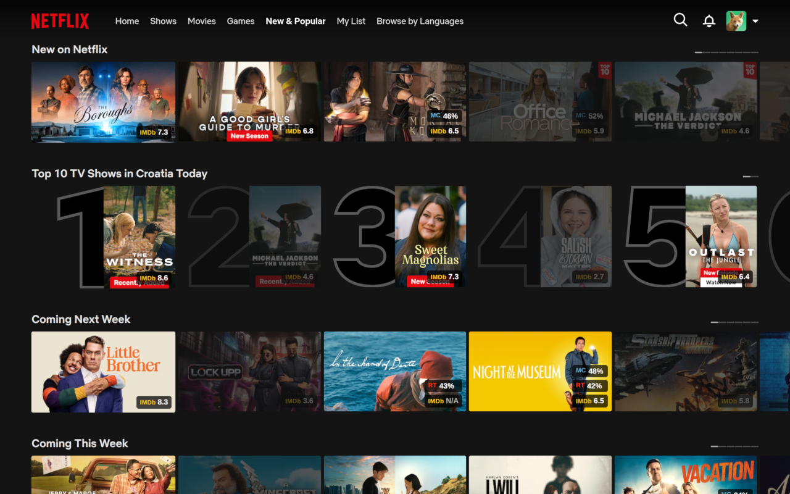
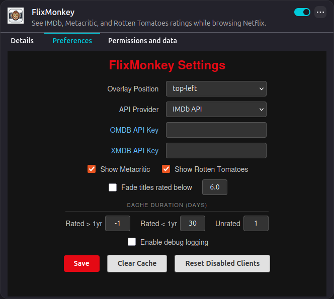

# FlixMonkey

[](https://github.com/fran2889/flix-monkey/releases)
[](https://chromewebstore.google.com/detail/flixmonkey/ipbiebdbicmlajmbcghkcdkobmcaoadl)
[](https://addons.mozilla.org/en-US/firefox/addon/flixmonkey/)
[](LICENSE)
[](https://github.com/fran2889/flix-monkey/actions/workflows/ci.yml)
[](https://github.com/fran2889/flix-monkey/actions/workflows/nightly.yml)

See IMDb, Metacritic, and Rotten Tomatoes ratings while browsing Netflix, HBO Max, and Disney+.

---

## Table of Contents

- [How It Looks](#how-it-looks)
- [Installation](#installation)
- [Features](#features)
- [Settings](#settings)
- [Troubleshooting](#troubleshooting)
- [Development](#development)
- [Privacy Policy](#privacy-policy)
- [License](#license)

---

## How It Looks

| Netflix browse view                                                               | Netflix title page                                                     |
| --------------------------------------------------------------------------------- | ---------------------------------------------------------------------- |
|  |  |

---

## Installation

Use the links below to install FlixMonkey for your browser.

[](https://chromewebstore.google.com/detail/flixmonkey/ipbiebdbicmlajmbcghkcdkobmcaoadl)
[](https://addons.mozilla.org/en-US/firefox/addon/flixmonkey/)
[](https://github.com/fran2889/flix-monkey/releases/latest/download/FlixMonkey.user.js)

> The userscript version requires [Tampermonkey](https://www.tampermonkey.net/) (Chrome, Edge, Firefox, Opera, Safari), [Violentmonkey](https://violentmonkey.github.io/) (Chrome, Edge, Firefox), or [Greasemonkey](https://www.greasespot.net/) (Firefox).

---

## Features

- **Rating Badges**: View IMDb ratings on titles, title previews, and detail pages. Metacritic and Rotten Tomatoes scores appear when the selected provider supplies them
- **Color-Coded Ratings**: Rating badges use a gradient from red (IMDb 5.0 or below; RT/MC 50% or below) to green (IMDb 8.5 or above; RT/MC 85% or above)
- **Click to Open**: Click the IMDb badge to open the title on IMDb, or search IMDb when no match is found
- **Fade Low-Rated Titles**: Fade titles rated below your chosen IMDb threshold
- **IMDb ID Overrides**: Hover a rating badge and click the pencil button to correct a mismatched IMDb ID
- **Smart Caching**: Cached ratings make repeat lookups instant
- **Auto-Disable**: A rating provider that returns a client error, such as an invalid API key or rate limit, is disabled for 1 hour to avoid repeated failing requests
- **Customizable**: Change badge position, choose rating provider, and more

---

## Settings

Access settings via:

- **Chrome**: Click the FlixMonkey icon in your browser toolbar, or open it from the extensions menu
- **Firefox**: Click the FlixMonkey icon in your browser toolbar, or go to `about:addons`, select FlixMonkey and go to the **Preferences** tab
- **Userscript**: On a supported streaming site, open your userscript manager (Tampermonkey/Violentmonkey/Greasemonkey) and click the **FlixMonkey Settings** menu item

Settings save automatically after a short delay. In the extension, badge position, visible ratings, and the fade threshold apply to open tabs without a reload. A rating provider change takes effect after you reload the page. In the userscript, reload the page after changing settings.



### Streaming Services

| Option  | Default     | Description                                                                 |
| ------- | ----------- | --------------------------------------------------------------------------- |
| Show on | All enabled | Enable or disable FlixMonkey individually for Netflix, HBO Max, and Disney+ |

### Display Settings

| Option          | Default         | Description                                                                      |
| --------------- | --------------- | -------------------------------------------------------------------------------- |
| Badge Position  | Top Left        | Corner where rating badges appear                                                |
| IMDb            | Yes (always on) | IMDb ratings are always displayed                                                |
| Metacritic      | No              | Display the Metacritic score. Available when OMDb or XMDb is the rating provider |
| Rotten Tomatoes | No              | Display the RT score. Available only when OMDb is the rating provider            |

### Rating Providers

| Option          | Default  | Description                                                                               |
| --------------- | -------- | ----------------------------------------------------------------------------------------- |
| Rating Provider | Agregarr | Active rating provider. Agregarr requires no API key and returns IMDb ratings only        |
| OMDb API Key    | _empty_  | [Get a free API key](https://www.omdbapi.com/apikey.aspx). Required when OMDb is selected |
| XMDb API Key    | _empty_  | [Get a free API key](https://xmdbapi.com/api-key). Required when XMDb is selected         |

### Fade Settings

| Option            | Default | Description                                                                                                |
| ----------------- | ------- | ---------------------------------------------------------------------------------------------------------- |
| Fade below rating | No      | Fade titles whose IMDb rating is below the threshold                                                       |
| Threshold         | 6.0     | IMDb rating below which to fade (0.0-10.0)                                                                 |
| Allow override    | No      | Show a fade override button on supported title surfaces that cycles through Auto, Always, and Never states |

### Cache Settings

| Option        | Default      | Description                                                                                            |
| ------------- | ------------ | ------------------------------------------------------------------------------------------------------ |
| Older Titles  | -1 (forever) | Cache duration in days for rated titles released more than one year ago. -1 never expires              |
| Recent Titles | 30           | Cache duration in days for rated titles released within the last year, or with an unknown release year |
| No Rating     | 1            | Cache duration in days for titles with no rating or no match                                           |

### Debug

| Option        | Default | Description                                                           |
| ------------- | ------- | --------------------------------------------------------------------- |
| Debug logging | Yes     | Write verbose logs to the browser console to help troubleshoot issues |

### Settings Actions

- **Clear Cache**: Remove all cached ratings, forcing fresh lookups for every title
- **Reset Providers**: Re-enable rating providers that were automatically disabled after errors

---

## Troubleshooting

**Rating badges are not showing**

Loading placeholder badges should appear immediately, before ratings are retrieved. If they do not, FlixMonkey is inactive or failed to load, or it is disabled for that service.

1. Verify the extension is enabled in your browser toolbar.
2. Verify FlixMonkey is enabled for this service under **Streaming Services > Show on**.
3. For the userscript version, confirm your userscript manager is active and the FlixMonkey script is loaded.
4. Refresh the Netflix, HBO Max, or Disney+ page.
5. Open browser developer tools (F12) and check the Console tab for errors.

**Badges are showing but there are no ratings**

Ratings can be missing because the provider failed or was disabled, or because it did not find the title. If the problem persists, select a different provider.

1. Open browser developer tools (F12) and check the Console tab for errors.
2. Check whether your provider was automatically disabled. Providers are disabled for 1 hour after client errors.
3. Use **Debug > Reset Providers** to re-enable a disabled provider.
4. Select a different rating provider to see whether the issue is provider-specific.

**Rating shown does not match the rating on the IMDb page**

FlixMonkey looks up titles by display name only, even when a service exposes additional card metadata. A mismatch can occur when multiple titles share the same name.

1. Hover the rating badge. The tooltip shows the title and year returned by the rating provider. Verify they match the title on Netflix, HBO Max, or Disney+.
2. If the tooltip confirms a match, the provider rating may be outdated because it is not read directly from IMDb. Recent releases have shorter cache times so ratings update sooner.
3. If the tooltip shows a different title, hover the badge and click the pencil button to set the correct IMDb ID. You can also select a different provider and clear the cache, because providers order search results differently.

**Metacritic and Rotten Tomatoes scores are not showing**

Most often, an MC/RT score is missing because the provider did not return one. Provider support does not guarantee a score for every title.

1. If MC/RT scores are missing on all titles, check your settings.
2. Check whether your provider supports these scores: OMDb supports both, and XMDb supports Metacritic only.
3. Make sure Metacritic and Rotten Tomatoes are enabled under **Display Settings > Show**.

**Ratings are loading slowly**

Rating providers are rate-limited, so FlixMonkey spreads requests over time. Cached ratings make later lookups instant.

1. Wait 10-15 seconds to see if ratings populate.
2. If ratings still do not appear, open browser developer tools (F12) and check the Console tab for errors.

**Still need help?**

Netflix, HBO Max, or Disney+ may change their layouts, breaking title discovery or badge positioning. A new FlixMonkey version may also have introduced a bug.

Please report these issues with as much detail as possible.

1. If you use OMDb or XMDb, verify your API key is configured correctly.
2. Open browser developer tools (F12) and check the Console and Network tabs for errors or relevant logs.
3. Open a [GitHub issue](https://github.com/fran2889/flix-monkey/issues) with details about the problem and steps to reproduce it.

---

## Development

FlixMonkey is written in TypeScript (ES2022, ES modules) and bundled by Rollup, with ESLint for linting, Prettier for formatting, and Vitest for testing.

This project requires Node.js 24 or newer.

```bash
npm install
npm run build       # Build all targets
npm run dev      # Watch mode with auto-rebuild
npm test            # Run unit and UI tests
```

To test locally:

1. Run `npm run build:chrome` or `npm run build:firefox`
2. In Chrome: go to `chrome://extensions`, enable **Developer mode**, click **Load unpacked**, and select `dist/chrome`
3. In Firefox: go to `about:debugging`, click **This Firefox**, then **Load Temporary Add-on**, and select `dist/firefox/manifest.json`

See [CONTRIBUTING.md](CONTRIBUTING.md) for full development details.

---

## Privacy Policy

FlixMonkey does not collect, store, or transmit any personal data about you.

**What it does:**

- **Title lookups**: When you browse Netflix, HBO Max, or Disney+, the title names visible on the page, or any IMDb ID you set as an override, are sent to third-party rating APIs (IMDb Suggestions, Agregarr, OMDb, and XMDb) solely to retrieve ratings. No account information, viewing history, or streaming-service credentials are included in these requests.
- **Local storage only**: Cached ratings, settings, and API keys stay in your browser's extension storage (or userscript storage). Apart from the API requests described above, this data never leaves your device. An OMDb or XMDb API key is sent only to the provider it belongs to.
- **No telemetry**: FlixMonkey does not include any analytics, crash reporting, or usage tracking of any kind.
- **No developer servers**: All network requests go directly from your browser to the third-party rating APIs. There is no intermediary server operated by this project.

**Third-party APIs:**

By default, title lookups use IMDb Suggestions for IMDb ID lookup and [Agregarr](https://agregarr.org/docs/imdb-ratings/) for ratings. When you opt in to OMDb or XMDb, which require your own API key, requests are made to [OMDb](https://www.omdbapi.com/) and/or [XMDb](https://xmdbapi.com/). Your use of these services is subject to their respective privacy policies.

---

## License

[GNU General Public License v3](LICENSE)
